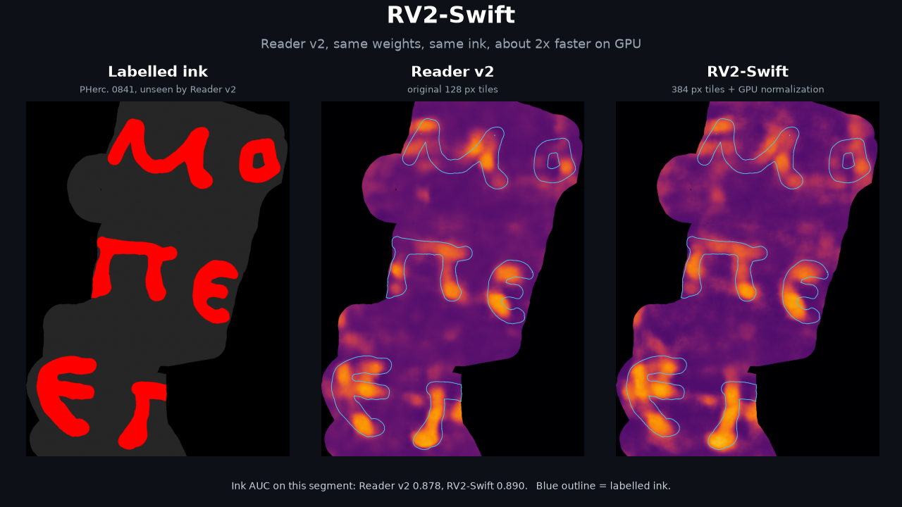
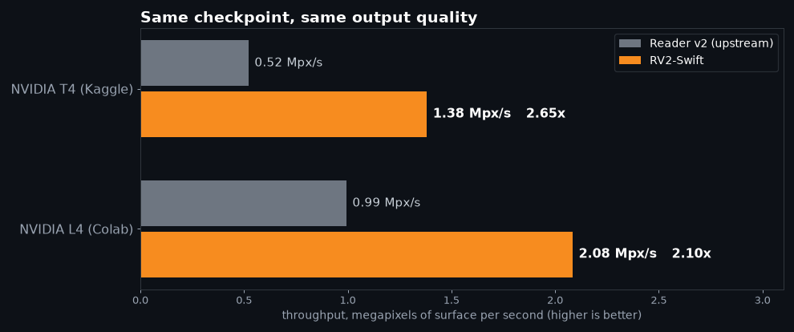

<p align="center"></p>

# RV2-Swift

**Reader v2, about 2x faster on GPU. Same checkpoint, same ink.**

RV2-Swift is a single-file, drop-in wrapper around villa's Reader v2 inference
(`koine_machines.inference.infer`). You keep the published checkpoint and the same command-line
arguments. Nothing is retrained, nothing is approximated, and on held-out labelled papyrus the ink
map is as good as upstream or slightly better.

| | Reader v2 (upstream) | RV2-Swift | |
|---|---|---|---|
| **Real segment PHerc. 0139 w043** (28 x 6120 x 8120, public), NVIDIA L4, wall time | 62.8 s | **32.0 s** | **1.96x** |
| NVIDIA T4 (Kaggle), throughput on large surfaces | 0.52 Mpx/s | **1.38 Mpx/s** | **2.65x** |
| NVIDIA L4 (Colab), throughput on large surfaces | 0.99 Mpx/s | **2.08 Mpx/s** | **2.10x** |
| CPU only (i7-7820HK laptop, one 0841 segment) | 190 s | **101 s** | **1.9x** |

Wall time includes Python start-up, imports and model loading (about 10 s, the same for both), so the gain
grows with the size of the surface. On small pieces it is modest: the three 0841 segments below (about 5
Mpx each, mostly masked) take 14.3 to 14.9 s upstream and 12.2 to 12.6 s with RV2-Swift on the same L4.

<p align="center"></p>

## Quality: measured on ink labels the model never saw

PHerc. 0841 has three segments with ink labels from the Vesuvius team, and Reader v2 was not trained
on that scroll. We ran both versions on all three and scored the predicted ink map against the
labels (AUC: 0.5 is chance, 1.0 is perfect).

| segment of PHerc. 0841 | Reader v2 | RV2-Swift |
|---|---|---|
| auto_grown_20260220174252405 | 0.816 | **0.823** |
| w00 | 0.878 | **0.890** |
| auto_grown_20260220144552896 | 0.813 | **0.826** |

RV2-Swift is never worse and gains about +0.01 on every segment. The GPU normalization is not an
approximation: its output is bit-identical to the CPU path (max abs difference 0.0, checked on full
segments and with `--self-test`).

## Install

RV2-Swift runs inside a normal Reader v2 setup:

```bash
git clone https://github.com/ScrollPrize/villa.git
cd villa && git checkout 3ea17f54a9b3d5fd1aaf73e1d2c8386dbaa9f30e   # merge-ink-pipelines, the version we tested
# install ink-detection as described in villa, then fetch the checkpoint:
#   huggingface.co/domenicor046/reader-v2 (revision 72633d8)
```

Copy `rv2_swift.py` anywhere and run it with the villa environment active. It needs nothing beyond
what Reader v2 already uses (PyTorch, numpy).

## Use

Same positional arguments as `koine_machines.inference.infer`:

```bash
python rv2_swift.py surface.zarr reader-v2.pth ink.tif \
    --stride 256 --blend-mode hann --batch-size 4 --num-workers 4 --no-compile --direction forward
```

| option | default | meaning |
|---|---|---|
| `--tile N` | 384 | inference window in pixels (`0` = upstream 128) |
| `--no-gpu-norm` | off | keep normalization on the CPU workers |
| `--self-test` | | compares GPU and CPU normalization, prints the max difference (expect 0.0) |

Settings we measured: tile 384, stride 256 (one third overlap; upstream uses 128 with stride 64),
Hann blending, batch 4 on GPU. Every other `infer.py` option passes straight through.

## How it works

Reader v2 spends most of its GPU time waiting for the CPU, not computing. Two changes remove the
wait.

**1. A bigger window over the same network.** The network is still built from the checkpoint at
its native 128 px; only the sliding window grows to 384 px. Being fully convolutional, it accepts
the larger input, and each pass sees more context. With stride 256 instead of 64 there are 16x fewer
forward passes, each 9x larger: about 1.8x less computation, and far fewer tile seams to blend,
which is also why the ink map gets slightly cleaner.

**2. Normalization moved to the GPU.** Upstream, every DataLoader worker runs `normalize_robust`
(1st and 99th percentiles, median, MAD) on the CPU for every patch, about 0.17 s per 17 x 384 x
384 patch. On a GPU machine that is the bottleneck. RV2-Swift lets the workers ship the raw
`uint8` patch (4x less data to move) and normalizes the whole batch on the GPU with the same math:
linear quantiles as in `np.percentile`, the same MAD scale and the same fallbacks for flat patches.
On a GTX 1070 that step drops from 0.18 s to 0.010 s per patch.

Neither change alone gives the full gain. On an L4, bigger tiles alone give 1.22x and GPU
normalization alone gives nothing (0.91x, the 128 px tiles are too small to keep the GPU busy);
together they give 2.1x.

## How we measured

* **Quality:** the three labelled 0841 segments above, full segment, forward direction, AUC over
  labelled pixels inside the valid mask. Upstream was run with its defaults (128 px tiles, stride
  64, Hann blending).
* **Speed, real data:** the public PHerc. 0139 segment `20260112000000-w043_2026011217`
  (9.362 um surface volume, 28 x 6120 x 8120), full segment, upstream with its defaults (128 px,
  overlap 0.5, batch 32) against RV2-Swift (384 px, stride 256, batch 4, GPU normalization), 4
  workers, NVIDIA L4, run twice back to back (62.8 / 62.8 s and 32.0 / 32.1 s). Upstream reads
  11,006 patches, RV2-Swift 745.
* **Speed, throughput:** synthetic 17-layer surfaces of 2048 and 6144 px; throughput is taken from
  the difference between the two sizes, so start-up is excluded. Same settings as above.
* **Identity:** the GPU-normalized output was compared pixel by pixel with the CPU-normalized
  output of the same run settings on a full 0841 segment: identical.

## Limits

* Speed was measured on T4, L4 and a GTX 1070. On an A100 the larger window alone gave 1.15x per
  pixel; GPU normalization should matter even more there, but we have not measured it on A100.
* Tested with `--no-compile`. `torch.compile` should work but is untested.
* Tested at villa commit `3ea17f5`. The wrapper patches two functions of `infer.py`
  (`roi_size_from_config`, `maybe_compile_model`) and the dataset's `__getitem__`; a large rewrite
  of `infer.py` upstream may need a small update here.

## Credits

Reader v2 is by Domenico Russo (`domenicor046/reader-v2`, MIT), inference code from
[ScrollPrize/villa](https://github.com/ScrollPrize/villa). RV2-Swift only changes how inference is
run. MIT license.
